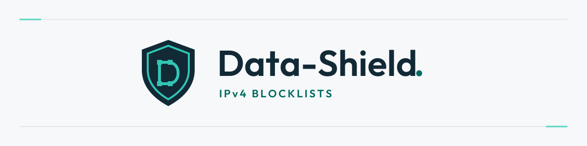

  <picture>
    <source media="(prefers-color-scheme: dark)" srcset="assets/data-shield-hero-dark.svg">
    
  </picture>

 

  
  
  
  
  
  

# Data-Shield IPv4 Blocklists

**Two complete lists. Clear choices. Controlled updates.**

Data-Shield provides maintained IPv4 blocklists for inbound filtering on firewalls, gateways and web application firewalls. Choose the policy that fits your environment, import its raw URL, and review its effect on legitimate traffic.

[Download standard](https://raw.githubusercontent.com/duggytuxy/Data-Shield_IPv4_Blocklist/refs/heads/main/prod_data-shield_ipv4_blocklist.txt) · [Download critical](https://raw.githubusercontent.com/duggytuxy/Data-Shield_IPv4_Blocklist/refs/heads/main/prod_critical_data-shield_ipv4_blocklist.txt) · [Report a false positive](https://github.com/duggytuxy/Data-Shield_IPv4_Blocklist/issues/new/choose)

## Choose your list

| Profile | Intended use | File |
| :--- | :--- | :--- |
| **Standard** | The starting point for Internet-facing services, with reviewed exceptions to reduce avoidable blocking. | [`prod_data-shield_ipv4_blocklist.txt`](prod_data-shield_ipv4_blocklist.txt) |
| **Critical** | A broader blocking policy for environments that accept stricter ingress filtering. Review the impact before deployment. | [`prod_critical_data-shield_ipv4_blocklist.txt`](prod_critical_data-shield_ipv4_blocklist.txt) |

Each file is complete and can be used on its own. Applying both lists combines their blocking decisions and may override the exceptions of the profile you intended to use.

The entry count changes over time. Check your product's capacity against the actual file, including whether it silently truncates oversized imports. There is no fixed 100,000-entry cap. Split files are no longer published; existing integrations must use one of the two complete files above.

## Stable download URLs

| Destination | Standard | Critical |
| :--- | :--- | :--- |
| **[GitHub](https://github.com/duggytuxy/Data-Shield_IPv4_Blocklist)** | [Raw file](https://raw.githubusercontent.com/duggytuxy/Data-Shield_IPv4_Blocklist/refs/heads/main/prod_data-shield_ipv4_blocklist.txt) | [Raw file](https://raw.githubusercontent.com/duggytuxy/Data-Shield_IPv4_Blocklist/refs/heads/main/prod_critical_data-shield_ipv4_blocklist.txt) |
| **[GitLab](https://gitlab.com/duggytuxy/Data-Shield-IPv4-Blocklist)** | [Raw file](https://gitlab.com/duggytuxy/Data-Shield-IPv4-Blocklist/-/raw/main/prod_data-shield_ipv4_blocklist.txt?ref_type=heads) | [Raw file](https://gitlab.com/duggytuxy/Data-Shield-IPv4-Blocklist/-/raw/main/prod_critical_data-shield_ipv4_blocklist.txt?ref_type=heads) |
| **[Codeberg](https://codeberg.org/duggytuxy21/Data-Shield_IPv4_Blocklist)** | [Raw file](https://codeberg.org/duggytuxy21/Data-Shield_IPv4_Blocklist/raw/branch/main/prod_data-shield_ipv4_blocklist.txt) | [Raw file](https://codeberg.org/duggytuxy21/Data-Shield_IPv4_Blocklist/raw/branch/main/prod_critical_data-shield_ipv4_blocklist.txt) |
| **[Bitbucket](https://bitbucket.org/duggytuxy/data-shield-ipv4-blocklist/src/main/)** | [Raw file](https://bitbucket.org/duggytuxy/data-shield-ipv4-blocklist/raw/HEAD/prod_data-shield_ipv4_blocklist.txt) | [Raw file](https://bitbucket.org/duggytuxy/data-shield-ipv4-blocklist/raw/HEAD/prod_critical_data-shield_ipv4_blocklist.txt) |
| **[jsDelivr CDN](https://cdn.jsdelivr.net/gh/duggytuxy/Data-Shield_IPv4_Blocklist@main/)** | [Raw file](https://cdn.jsdelivr.net/gh/duggytuxy/Data-Shield_IPv4_Blocklist@refs/heads/main/prod_data-shield_ipv4_blocklist.txt) | [Raw file](https://cdn.jsdelivr.net/gh/duggytuxy/Data-Shield_IPv4_Blocklist@refs/heads/main/prod_critical_data-shield_ipv4_blocklist.txt) |

These are the existing download URLs used by SysWarden. The two filenames and their paths remain unchanged. GitLab manages repository mirroring to Codeberg and Bitbucket. jsDelivr serves a cached copy from GitHub, so CDN refreshes can lag behind publication.

Use a raw file URL in your firewall's feed configuration. A repository or preview-page URL returns a web page, not the blocklist.

## Format and updates

- Plain text, with one public IPv4 address per line.
- No headers, comments, ports, CIDR ranges or IPv6 entries.
- Duplicate addresses removed and addresses sorted numerically.
- Generation scheduled **every two hours**. A new commit appears only when published file content changes.
- Both files validated before publication and committed together on GitHub and GitLab. Downstream mirrors and CDN caches can differ until they refresh.
- Failed generation checks preserve the last validated files. Failed publication is retried independently.

The public repository distributes the lists and their usage documentation. Review a file's commit history to check when its content last changed. Neither a successful download nor an unchanged commit proves that your firewall has applied the latest available data.

## Deployment strategy

1. **Start with the standard profile.** Check the number of entries and your device's import limits.
2. **Apply the list to inbound Internet traffic.** Match the remote source address on traffic reaching the gateway or your published services. Do not apply the feed as a blanket outbound destination blocklist.
3. **Review rule ordering and local exceptions.** Preserve required administration and business access. A whitelist must take precedence according to your firewall's own rule model.
4. **Observe before broad enforcement.** Use logging or a limited deployment to inspect matches and identify legitimate services that need exceptions.
5. **Refresh and monitor.** Configure automatic retrieval where supported. Check fetch failures, truncation warnings and the number of entries actually loaded. Keep the last working rules if a download or import fails.

### Platform integration guides

The [Data-Shield website documentation](https://data-shield.eu/docs/) provides setup instructions, copyable feed URLs and commands, capacity checks, and verification steps for ten platforms:

| Platform | Integration method |
| :--- | :--- |
| **[FortiOS / FortiGate](https://data-shield.eu/docs/fortios/)** | Native HTTPS IP address external feed. |
| **[UniFi](https://data-shield.eu/docs/unifi/)** | Dynamic IPv4 Network List with zone-based firewall policies. |
| **[Palo Alto / PAN-OS](https://data-shield.eu/docs/palo-alto/)** | IP External Dynamic List with certificate validation. |
| **[OPNsense](https://data-shield.eu/docs/opnsense/)** | Regularly refreshed URL table alias. |
| **[pfSense CE / Plus](https://data-shield.eu/docs/pfsense/)** | Native URL Table (IPs), with daily refresh and capacity checks. |
| **[Sophos Firewall](https://data-shield.eu/docs/sophos/)** | SFOS 22.0 third-party threat feeds, with entitlement and polling checks. |
| **[VyOS](https://data-shield.eu/docs/vyos/)** | Native remote groups, with release-specific refresh settings. |
| **[MikroTik RouterOS](https://data-shield.eu/docs/routeros/)** | RouterOS v7 with a Linux controller for verified complete-feed updates. |
| **[OpenWrt](https://data-shield.eu/docs/openwrt/)** | OpenWrt 25.12 with native banIP feeds and scheduled two-hour reloads. |
| **[Stormshield / SNS](https://data-shield.eu/docs/stormshield/)** | Validated CSV conversion and manual custom web services import. |

The [UniFi guide in this repository](docs/unifi.md) also remains available. Check the guide for your release and appliance model. Product refresh intervals can be longer than Data-Shield's generation interval; the Stormshield workflow requires a manual import.

IP-based blocking is one layer of protection. It complements application security, patching, authentication, rate limiting and monitoring. It cannot identify every attack, and shared or reassigned addresses can produce false positives.

## False positives and corrections

[Open a false-positive report](https://github.com/duggytuxy/Data-Shield_IPv4_Blocklist/issues/new/choose) with:

- The affected IPv4 address and the list you use.
- The legitimate service affected and the time of the observed block.
- A concise explanation and sanitized evidence that helps reproduce the issue.

Do not post credentials, private logs or personal information in a public issue. For sensitive evidence or security vulnerabilities, follow the [security policy](SECURITY.md). If access must be restored immediately, apply a narrowly scoped local exception while the report is reviewed.

## Project and support

Maintained by **Laurent Minne / Duggy Tuxy**. If these lists help protect your services, you can [support their maintenance on Ko-fi](https://ko-fi.com/laurentmduggytuxy).

For Linux host protection, explore [SysWarden](https://syswarden.io) and its [repository](https://github.com/duggytuxy/syswarden).

See [contributing](CONTRIBUTING.md), the [code of conduct](CODE_OF_CONDUCT.md), and the [GNU GPLv3 license](LICENSE).

Copyright 2023-2026 Laurent Minne / Duggy Tuxy.
